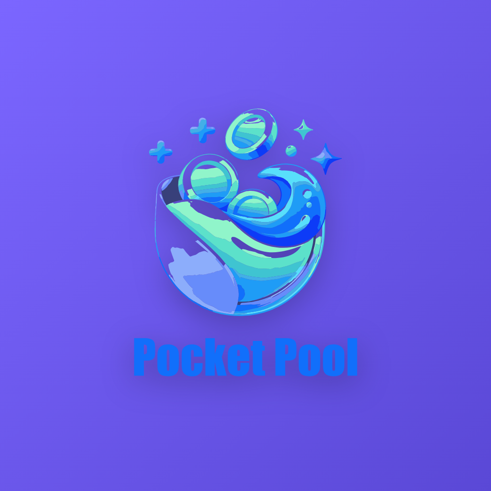

# PocketPool 🎱💸

<p align="center">
  
</p>

<p align="center">
  <strong>Modern, Offline-First Mobile Application for Group Expense Tracking & Pool Budget Management</strong>
</p>

<p align="center">
  
  
  
  
  
  
</p>

---

## 📖 Overview

**PocketPool** is a full-featured, local-first mobile application built with React Native and Expo. It empowers groups (travelers, roommates, event organizers, project teams) to effortlessly track pool contributions, record shared expenses, monitor remaining balances in real time, and receive threshold alerts without requiring an external backend or cloud account.

All transactions, member profiles, and settings persist securely on-device using a **100% local JSON architecture**.

---

## ✨ Key Features

### 💰 Real-time Pool Budget Calculations
- **Member Contributions**: Deposit amounts add directly to the Total Pool Budget.
- **Deductions**: Expense records deduct from the remaining pool budget in real time.
- **Remaining Budget & Percentage Spent**: Live progress indicators track budget health with visual status pills (Healthy Pool vs. Low Budget vs. Deficit).

### 👥 Member Management & Group Collaboration
- Manage all group members with custom names, avatar colors, contact info, and initial deposits.
- **Synchronized State**: Member additions and deletions reflect across all screens (Home, Members, Add Transaction, and Insights).
- Quick deposit shortcuts per member to easily log top-up contributions.

### 🔔 Smart Alert Threshold System
- Configurable threshold limit (e.g., $300, €250, etc.).
- Automated warning alerts trigger as soon as remaining pool funds cross below the threshold.
- Critical deficit alerts trigger if the pool is exhausted or balance turns negative.

### 🧾 Receipt Picture Attachment & Fullscreen Viewer
- Attach receipt images directly to expense records using the device camera or photo library via `expo-image-picker`.
- In-app thumbnail preview and a full-screen image viewer.
- One-tap sharing of receipt attachments using `expo-sharing`.

### 📄 Professional PDF & CSV Export Engine
- Generate formatted invoices and reports for:
  - **Single Transaction** (Individual receipt invoice)
  - **Last 7 Days** (Weekly activity summary)
  - **Last 30 Days** (Monthly activity summary)
  - **All-Time** (Complete pool financial statement)
- Export to clean, printable **PDF** documents with PocketPool branding, or RFC-4180 compliant **CSV** spreadsheets for Excel/Google Sheets.

### 🔒 Biometric Security & 4-Digit PIN Lock
- Protect sensitive group financial data on app launch using native biometrics (**Face ID / Touch ID / Biometric Prompt** via `expo-local-authentication`).
- Fallback 4-digit security PIN for devices without biometric hardware.
- "Lock Now" capability from Settings.

### 🌐 Multi-Currency Support & Staged Settings
- Supports worldwide currencies: **USD ($)**, **EUR (€)**, **GBP (£)**, **JPY (¥)**, **CAD (C$)**, **AUD (A$)**, **INR (₹)**, **PKR (₨)**, and **CHF (Fr)**.
- Settings modifications (currency symbol/code, alert threshold, group pool name) feature draft staging and require explicit **"Save Settings"** confirmation before committing to storage.
- Selected currency changes dynamically propagate throughout the entire app.

### 🧹 Dual Reset Options in Settings
- **Reset App to Zero (Clean Default)**: Wipes all transactions, expenses, contributions, and members, setting budget to `$0.00` and 0 members for a fresh start with zero demo data.
- **Reset to Demo Data**: Restores the 4 sample members (*Alex Rivera, Sarah Chen, David Miller, Emma Watson*) and initial sample contributions and expenses.

### 🧭 Symmetrical 5-Slot Navigation
- **Left 1**: Pool Dashboard (Home)
- **Left 2**: Members Management
- **Center**: Raised Gradient FAB (+) for rapid addition of expenses or contributions
- **Right 1**: Insights & Analytics
- **Right 2**: Settings & Backup

---

## 🎨 UI/UX Design System

| Element | Specification |
| :--- | :--- |
| **Primary Gradient** | `#7B66FF` &rarr; `#5A48D6` (Headers, active states, buttons) |
| **Background** | `#F8FAFC` (Canvas), `#FFFFFF` (Cards & Sheets) |
| **Typography** | Sans-serif with dynamic contrast hierarchy (`#1F2937`, `#64748B`, `#FFFFFF`) |
| **Category Accents** | Food (Orange), Transport (Blue), Shopping (Green), Fun (Pink), Bills (Purple) |
| **Border Radii** | `12px` (Inputs), `20px` (Cards), `28px` (Hero Metrics), `9999px` (Pills/Buttons) |
| **Accessibility** | Complete TalkBack / VoiceOver screen reader labels and accessibility roles |

---

## 🏗️ Codebase Structure

```
PocketPool/
├── assets/                       # Isolated transparent branding icons & splash assets
│   ├── icon.png                  # App icon (1024x1024)
│   ├── splash-icon.png           # Splash screen logo
│   └── android-icon-foreground.png
├── src/
│   ├── components/
│   │   ├── common/               # Header, Button, Card, Badge, AlertBanner, Logo
│   │   ├── dashboard/            # HeroMetric, StatsRow, SpendingTrendChart, CategoryBreakdown, TransactionList
│   │   ├── insight/              # InsightHeroMetric, InsightLineChart, CategoryRankingList, ContributionShareList
│   │   ├── navigation/           # Symmetrical BottomTabBar with central FAB
│   │   ├── security/             # BiometricLockScreen with PIN pad fallback
│   │   ├── settings/             # CurrencyPicker, ThresholdSlider, ExportManager
│   │   └── transaction/          # CategoryGrid, MemberSelector, PaymentMethodSelector, ReceiptAttachmentArea
│   ├── context/
│   │   └── PocketPoolContext.tsx # Centralized application state and persistent storage bridge
│   ├── screens/
│   │   ├── SplashScreen.tsx      # Branded animated splash sequence
│   │   ├── DashboardScreen.tsx   # Main pool dashboard with metrics & activity
│   │   ├── MembersScreen.tsx     # Member list, quick deposits, and add member form
│   │   ├── InsightScreen.tsx     # Timeframe analytics & category breakdowns
│   │   ├── AddTransactionScreen.tsx # Record deposits and expenses with receipt capture
│   │   └── SettingsScreen.tsx    # Currency, threshold, biometrics, JSON manager & reset
│   ├── services/
│   │   ├── biometrics.ts         # FaceID / TouchID native authentication wrappers
│   │   ├── calculations.ts       # Budget aggregation, threshold checks & trend math
│   │   ├── export.ts             # PDF invoice generation via expo-print & CSV exporter
│   │   ├── receiptSamples.ts     # Bundled offline receipt image presets
│   │   └── storage.ts            # Local JSON database engine with backup import/export
│   ├── theme/                    # Color palette, shadows, spacing & border radii
│   └── types/                    # TypeScript interfaces for models & navigation
├── tests/
│   ├── budget_math.test.ts       # Unit tests for contributions & expense math
│   ├── threshold_alert.test.ts   # Unit tests for alert threshold triggers
│   ├── export_logic.test.ts      # Tests for timeframe filters, CSV and PDF HTML output
│   ├── local_storage.test.ts     # Tests for JSON read/write, export/import & reset
│   ├── setup.ts                  # Mock environment for headless Node.js test execution
│   └── run_all_tests.ts          # Automated runner executing all test suites
├── App.tsx                       # Main entry point & navigator
├── app.json                      # Expo configuration & native permissions
└── package.json                  # Dependencies & execution scripts
```

---

## 🚀 Getting Started

### Prerequisites
- [Node.js](https://nodejs.org/) (v18 or higher recommended)
- [npm](https://www.npmjs.com/) or [bun](https://bun.sh/)
- [Expo Go](https://expo.dev/go) app on your mobile device (or an Android emulator / iOS simulator)

### Installation

1. **Clone the repository:**
   ```bash
   git clone https://github.com/abdulmoiddd/Pocket-Poll-Mobile-App-for-expance-tracking-in-group.git
   cd Pocket-Poll-Mobile-App-for-expance-tracking-in-group
   ```

2. **Install project dependencies:**
   ```bash
   npm install
   ```

3. **Start the Expo development server:**
   ```bash
   npx expo start
   ```

4. **Launch on your device:**
   - Scan the terminal QR code using **Expo Go** (Android) or the **Camera** app (iOS).
   - Press `a` in the terminal to launch in an Android Emulator.
   - Press `w` to open in your web browser.

---

## 🧪 Automated Testing & Verification

PocketPool includes a standalone automated test suite verifying all financial calculations, alert thresholds, invoice generation, and JSON storage operations:

```bash
npm test
```

### Test Coverage Highlights
- ✅ **Budget Calculations**: Verifies contribution addition, expense deductions, remaining balance, and percentage spent.
- ✅ **Threshold Alerts**: Tests warning threshold crossing, subsequent deductions, deficit states, and recovery triggers.
- ✅ **Export Logic**: Tests single transaction, 7-day, 30-day, and all-time timeframe filters, CSV escaping, and PDF invoice rendering.
- ✅ **Local Storage**: Tests JSON schema initialization, read/write, JSON backup import/export, `resetToDefaults()`, and `resetToZero()`.

Type verification:
```bash
npx tsc --noEmit
```

---

## 📦 Android APK Build

A precompiled standalone release APK is available in the root of the repository:
- **File**: `PocketPool.apk` (~37.5 MB)
- **Package**: `com.pocketpool.app` (v1.0.0)
- **Runtime**: Bundled Hermes JavaScript bytecode (100% offline ready, no local Metro server needed)

### Building the APK Locally
To recompile the Android APK on your machine using Gradle:

```powershell
# 1. Prebuild native Android project via Continuous Native Generation
npx expo prebuild --platform android --clean

# 2. Assemble release APK
cd android
.\gradlew.bat assembleRelease
```
The output APK is generated at `android/app/build/outputs/apk/release/app-release.apk`.

To install directly to a connected Android device with USB debugging enabled:
```powershell
adb install -r PocketPool.apk
```

---

## 📄 License

This project is licensed under the [MIT License](LICENSE).
